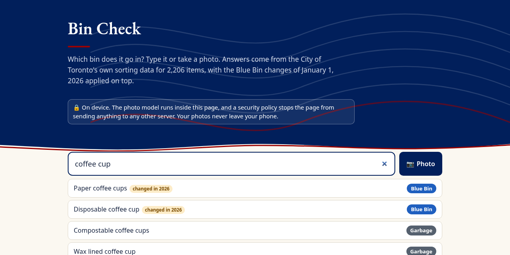
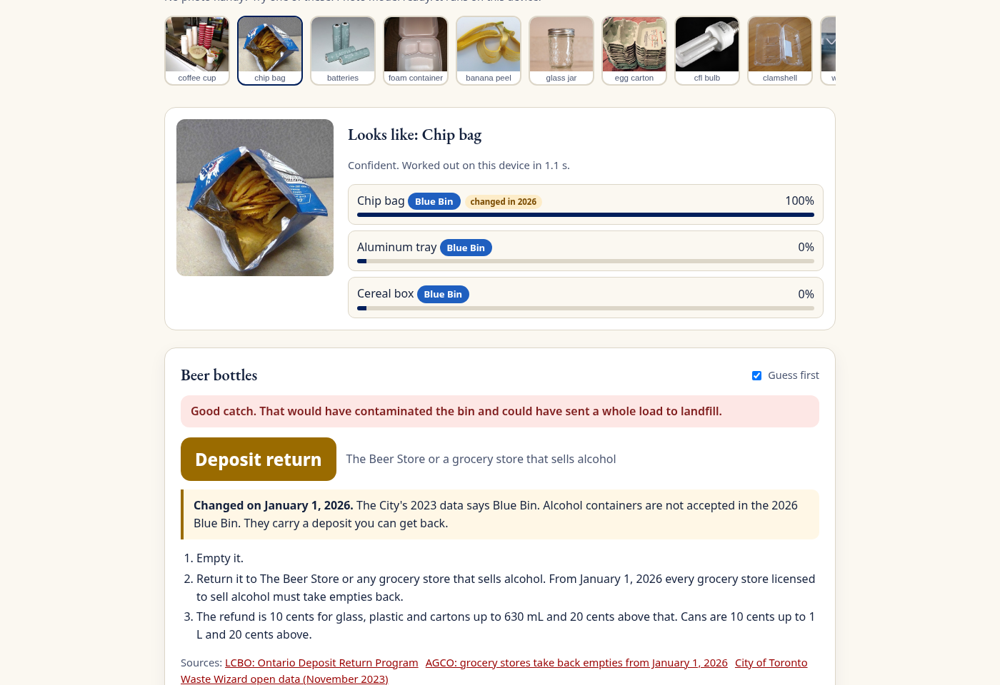
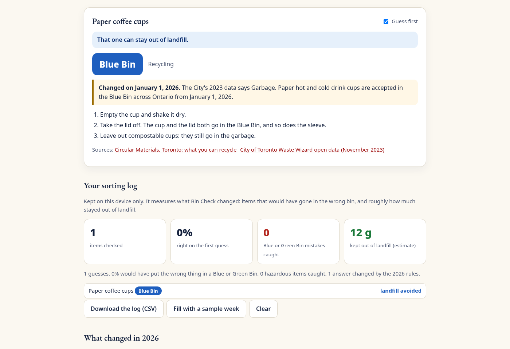
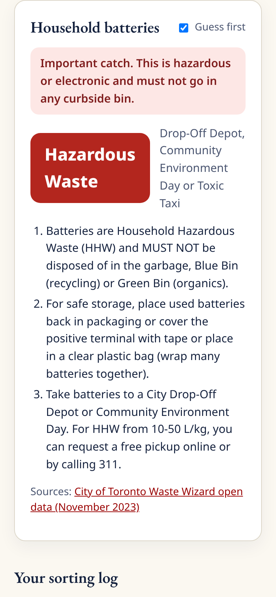

# Bin Check

   

Which bin does it go in? Type it or take a photo, and Bin Check tells you, for Toronto, with the rules that took effect on January 1, 2026.

* **2,206 items** from the City of Toronto's own Waste Wizard data
* **the 2026 Blue Bin list applied on top.** The City's open data file is from November 2023. When Circular Materials took over the residential Blue Bin this year, coffee cups, chip bags, black plastic, toothpaste tubes, blister packs and foil became recycling, and beer and wine containers left it. Bin Check corrects **145** of the old answers (34 items change bin, 111 lose outdated black plastic advice) and links the source on every one
* **photo sorting on your device.** MobileCLIP S0, a small image model from Apple, runs in the browser. It compares your photo with 153 descriptions of 81 common items in about a second and shows its top three guesses with how sure it is. The photo never leaves your phone
* **guess first.** You say where you would have put it, then see the answer. That turns every lookup into a measurement
* **a sorting log** on your device: how often you were right, Blue and Green Bin mistakes caught, hazardous items caught, and a rough count of grams kept out of landfill, with a CSV download
* **deposit return** for alcohol containers, with the refund amounts, and clear handling for hazardous waste and electronics
* typo tolerant search with everyday words (styrofoam, pop, tinfoil, K-Cup)

A security policy in the page blocks every request to any other server, and the browser check proves it.

Live: https://alenzacodes.github.io/bin-check/

On a phone:

A 2 minute captioned demo is in [docs/demo-captioned.mp4](docs/demo-captioned.mp4).

## Why
In Toronto, 35% of what goes in the Blue Bin is contamination, one of the highest rates in Ontario (City of Toronto, Infrastructure and Environment Committee background file 284617, 2026). A load that is too contaminated can be sent to landfill, and the 2026 change to the accepted list means a lot of what people learned is now wrong. The question at the bin is always the same: which one? Bin Check answers it in a few seconds, with the current rules, and keeps count of what it caught.

## How it works
All the logic is in plain JavaScript modules that run the same in the browser and in Node.

1. **Data.** `tools/build-data.mjs` turns the City's Waste Wizard JSON into `src/data/items.js`: 2,206 items, their names and aliases, the bin and the City's instructions.
2. **The 2026 overlay.** `src/rules2026.js` lists every item the 2026 Blue Bin list changes, with the new bin, plain steps and the source. It also removes instructions that the new list makes wrong (111 items still say to put black plastic in the garbage) and adds 2026 notes for glass lids and box sizes. Where the new list is silent, as with black foam, Bin Check keeps the safe answer and says so.
3. **Search.** Names are normalised, plurals stemmed, common synonyms expanded, and typos fixed with a Damerau Levenshtein distance against the item vocabulary. Exact and prefix matches rank first, then the share of query words matched, then shorter, more general names.
4. **Photos.** `tools/embed-labels.mjs` precomputes MobileCLIP S0 text embeddings for 153 prompts covering 81 common items, stored as int8. In the browser, `src/vision.js` loads the fp16 image model (23 MB) and ONNX Runtime Web (14 MB) from this site's own files, embeds the photo, and `src/matcher.js` ranks labels by cosine similarity with a softmax. The top three are shown with a confidence word, and you confirm.
5. **Measurement.** `outcome()` classifies each guess as right, contamination caught (a wrong Blue or Green Bin guess), landfill avoided (garbage guessed, but it can be diverted) or hazard caught. `summarize()` turns the log into rates and grams, using a rough typical weight for each photo label.

## Data sources
* City of Toronto, Waste Wizard Lookup Table, Toronto Open Data, file dated November 27, 2023: https://open.toronto.ca/dataset/waste-wizard-lookup-table/ (a copy is in `data/`)
* Circular Materials, Toronto, what you can recycle, opened October 29, 2026: https://www.circularmaterials.ca/resident-communities/toronto/
* Circular Materials, new materials across Ontario in 2026: https://www.circularmaterials.ca/news/ontario-new-materials/
* City of Toronto, Blue Bins no longer City run: https://www.toronto.ca/news/blue-bins-no-longer-city-run-what-to-expect-january-1-2/
* LCBO, Ontario Deposit Return Program (refund amounts): https://hellolcbo.com/app/answers/detail/a_id/193/
* AGCO, grocery stores take back empties from January 1, 2026: https://www.agco.ca/en/news/all-grocery-store-licensees-required-participate-ontario-deposit-return-program-january-1-2026
* Contamination rate: City of Toronto, Ontario's Transition to Extended Producer Responsibility, background file 284617 (2026): https://www.toronto.ca/legdocs/mmis/2026/ie/bgrd/backgroundfile-284617.pdf
* Sample photos: Wikimedia Commons, see [docs/samples/CREDITS.md](docs/samples/CREDITS.md)

## Run it

    python3 -m http.server 8000

then open http://localhost:8000/. There is no build step. The photo model loads the first time you use a photo (about 37 MB).

## Tests
Needs Node 20 or later. No dependencies.

    node --test

23 tests cover the City data, every 2026 rule and photo label pointing at a real item, the coffee cup, deposit return, flexible packaging, books and black plastic changes, the honest black foam note, glass and box notes, search with synonyms, plurals and typos, the edit distance, the label ranking maths, the photo matcher on 11 real photos (all 11 right in the top three, 9 of 11 right first), the guess outcomes, the log summary, the CSV export and the network lock.

The browser check serves the site, loads it in headless Chrome, runs a search and the guess first flow, recognises a sample photo with the real model on device, fills the log, confirms there are no console errors and confirms that a request to an outside server is blocked:

    pip install playwright
    python3 scripts/browser_check.py          # add --shots to refresh the screenshots
    python3 scripts/record_demo.py            # records the captioned demo video

To rebuild the label embeddings you need the full model files, which are not in the repo because the text model is 170 MB:

    cd tools && npm install
    # download config.json, preprocessor_config.json, tokenizer.json, tokenizer_config.json and
    # onnx/text_model.onnx from https://huggingface.co/Xenova/mobileclip_s0 into ../models/Xenova/mobileclip_s0/
    node embed-labels.mjs && node embed-photos.mjs

## Files

    index.html                    the page, with its Content Security Policy
    src/engine.js                 search, the 2026 overlay, label ranking, outcomes, the log summary and CSV
    src/rules2026.js              every 2026 change with its source
    src/labels.js                 81 photo labels, their prompts, items and typical weights
    src/matcher.js, src/vision.js the on-device photo matcher
    src/app.js                    the interface
    src/data/items.js             the City's 2,206 items (generated)
    src/data/label-embeds.js      MobileCLIP text embeddings (generated)
    src/vendor/                   Transformers.js and ONNX Runtime Web, unmodified, with their licences
    models/Xenova/mobileclip_s0/  the fp16 image model and Apple's licence
    tools/                        data and embedding builders
    scripts/                      browser check and demo recorder
    tests/                        Node tests and the photo embedding fixture

## Limits
* A guide, not the City's ruling. If the City or Circular Materials says otherwise for your building, they win.
* The photo model knows 81 kinds of item, not all 2,206. Search covers the rest. It can be fooled by unusual angles, and it cannot see whether a container is clean, so the steps always say.
* Weights in the log are rough typical weights, for a sense of scale only.
* Apartments, businesses and some institutions follow different rules from houses.

## Credits
* Sorting data: City of Toronto (Toronto Open Data) and Circular Materials
* MobileCLIP S0 by Apple, ONNX conversion by Xenova, under Apple's licence (in `models/`)
* Transformers.js by Hugging Face (Apache 2.0) and ONNX Runtime Web by Microsoft (MIT)
* The navy and red theme in `src/theme/` is shared across my earlier projects
* Code written with AI assistance, then reviewed and tested

Made by John Khan in Toronto, Ontario. MIT licence.
